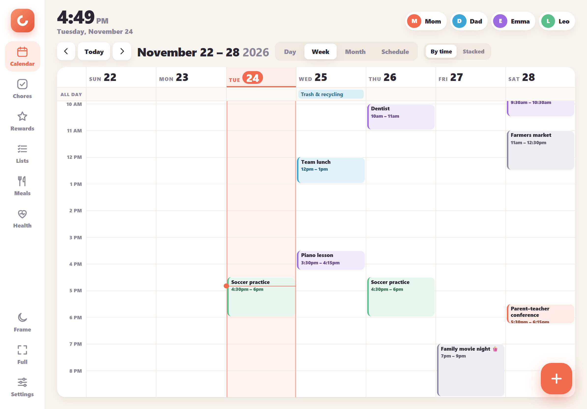
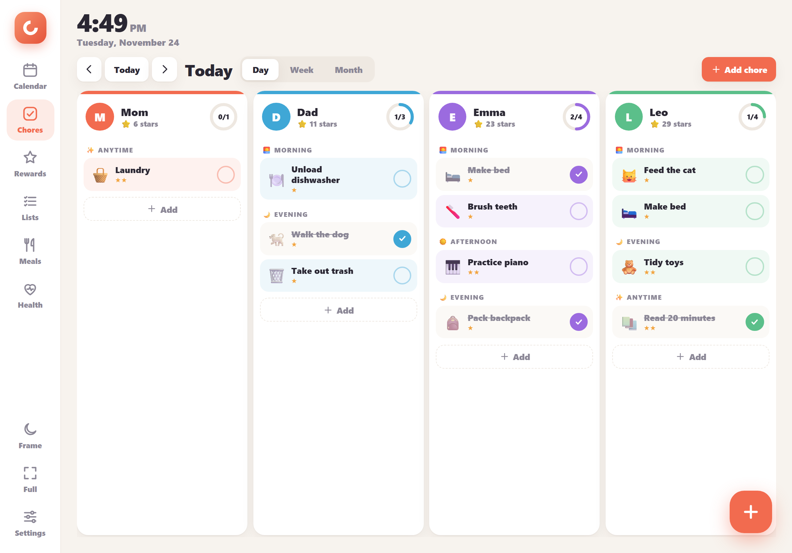
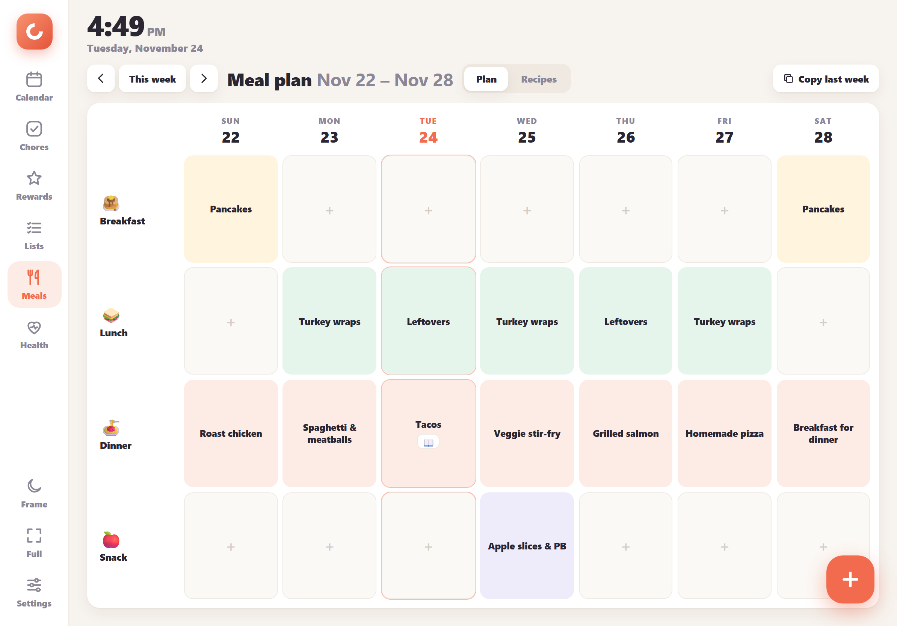

# Calendora

[](https://github.com/gh1d0ra/calendora/actions/workflows/ci.yml)


A touch-friendly family wall calendar that runs in any web browser. Put it full-screen on a tablet, a spare monitor or a TV and it becomes the family's shared hub.

**▶ Try it:** [open the demo family](https://calendora.igorrash.workers.dev/?demo). It's made up, needs no sign-in, and nothing you change is saved. The [GitHub Pages copy](https://gh1d0ra.github.io/calendora/) shows the same demo.

| Week (wall tablet) | Chores |
|---|---|
|  |  |
| **Month** | **Meal plan** |
|  |  |

<sub>Screenshots use the app's built-in demo family. Phone layout: [one day per screen](docs/screenshots/phone-week.png).</sub>

## How it's built

- **One Cloudflare Worker** serves the app and a JSON API on **D1** (SQLite), with a cron trigger (AnyList sync) and **Workers AI** (recipe photos, sorting lists).
- **Google sign-in, verified on the server:** RS256 ID tokens are checked against Google's keys. Families have owner, admin and member roles and invite links; wall tablets use a PBKDF2-hashed passcode with rate limiting.
- **Stateless HMAC-signed sessions**, with a per-family epoch for "sign out all devices".
- **Offline-first sync:** each device keeps a full copy. Saves are conditional on the board version, and conflicts are resolved with a section-by-section three-way merge.
- **Live updates:** each family has a **Durable Object** that its open screens hold a WebSocket to (Hibernation API, so idle tablets cost nothing). A save on one phone shows on the kitchen tablet within a second. D1 stays the source of truth.
- **Background jobs on Cloudflare Queues:** AnyList sync and re-fetching calendars whose source is down, with exponential backoff and a dead-letter queue.
- **A second language where it fits:** phone-calendar subscribe feeds are rendered by a **Python Worker** behind a service binding. It's checked from both sides: the Python tests and the JavaScript iCalendar engine read the same file.
- **Repeating events, time zones and iCalendar** are handled in `lib/core.js` (RRULE, EXDATE, moved and cancelled instances, daylight-saving changes) with no libraries.
- **Observability:** every request and job is recorded in Workers Analytics Engine, with structured logs and targets (availability, board p95, conflict rate) checked by `scripts/metrics.mjs`.
- **Security:** a [threat model](docs/threat-model.md), security headers, and a Content-Security-Policy rolled out report-only first, with a reporting endpoint.
- **Infrastructure as code:** Terraform for the D1 database and queues (existing resources imported); Wrangler for the code.
- **Tested at four levels:**
  - Vitest unit tests;
  - API tests inside the real Workers runtime (workerd) with D1, Durable Objects and queues;
  - Python tests;
  - Playwright end-to-end tests on tablet and phone sizes.

  There are also k6 load tests for board sync.

More: [architecture](docs/architecture.md), [design decisions](docs/decisions/), [observability](docs/observability.md), [threat model](docs/threat-model.md).

## Features

- **Calendar** with Day, Week, Month and Schedule views
  - Every family member gets a color. Tap their avatars in the header to show or hide their events.
  - Day view puts each person in their own column, with a "now" line.
  - Repeating events: daily, weekdays, weekly on chosen days, every 2 weeks, monthly and yearly, plus an optional end date. You can delete one occurrence, this and all following, or the whole series.
  - All-day and multi-day events, locations and notes.
  - Swipe left or right, or use the arrow keys, to move through dates.
- **Chores** in a column per person, grouped by morning, afternoon, evening and anytime. Each column has a progress ring, and finishing everything sets off confetti.
- **Rewards**: chores earn stars, and stars are redeemed for rewards the family sets up.
- **Lists** for groceries, to-dos, packing and so on. Add several items at once by separating them with commas.
- **Meal plan**: a week grid for breakfast, lunch, dinner and snacks. Dinner also shows on the week view. You can copy last week's meals, and a meal's ingredients can be sent to the grocery list.
- **Recipes**: attach a recipe to any meal by pasting a link (ingredients and steps are pulled from the page, and the original link is kept), taking or uploading a photo (keep the photo, or have Cloudflare Workers AI transcribe it), or typing it in. The 📖 button opens a cooking view that keeps the screen awake and stays open on that device until someone closes it, with ingredients you can tick off, the current step highlighted, and a button to add the ingredients to Groceries.
- **Photo frame**: when the calendar sits idle, it plays a slideshow of your photos with the time, the weather and today's events.
- **Google Calendar two-way sync**: show your Google calendars, give each one to a family member, and save new events straight to Google.
- **Apple (iCloud) calendars, read-only**: paste a calendar's Public Calendar link and choose whose it is. The Worker fetches the feed and the app expands repeating events, time zones, skipped dates and moved instances. It refreshes about every 15 minutes.
- **AnyList shopping-list sync (unofficial)**: keeps one Calendora list and one AnyList list matched in both directions, covering adding, renaming, checking off and deleting items. It runs every minute and right after the list is edited in Calendora. To set it up, add `ANYLIST_EMAIL` and `ANYLIST_PASSWORD` as Worker secrets, then switch it on in Settings.
- **Subscribe on your phone**: a secret link adds Calendora's events (everyone's, or one person's) to Apple, Google or Outlook calendar. Repeats, skipped dates and multi-day events come through, and a new link turns the old one off.
- **Weather**: free forecast from Open-Meteo, shown in the header and on each day in the week view.
- Full-screen mode, a 12- or 24-hour clock, a choice of first day of the week, and backup export and import.

## Where data lives

Calendora is a Cloudflare Worker (`src/worker.js`). It serves the app files and a small JSON API backed by a Cloudflare D1 database.

- **Family board (shared):** members, events, chores and stars, rewards, lists, meals and settings are stored in D1 as one JSON document. Every signed-in device stays in sync. Changes are saved within about half a second, and open screens are told about them right away over a live connection. They also check every minute (every 15 seconds without a live connection).
- **Sign-in:** a single family passcode. D1 stores only a salted PBKDF2 hash of it. Each device stays signed in for a year through an HttpOnly cookie, and Settings can sign out every other device.
- **Kept on each device:** Google Calendar sign-in, photos (IndexedDB), and which members are shown or hidden.
- **Offline:** the app keeps working from its local copy and syncs when it's back online.

Opened anywhere else (a local file, or GitHub Pages), the app runs in local-only mode in the browser.

## Running it

It's plain HTML, CSS and JavaScript with no build step.

- Open `index.html` in a browser, or
- serve the folder with any static server, for example `python3 -m http.server`, or
- deploy to Cloudflare: Workers Builds redeploys on every push to `main`. The settings are in `wrangler.toml`, and the D1 tables are created automatically on first use.

Keyboard shortcuts: `←` and `→` move through dates, `t` jumps to today, `d`, `w`, `m` and `s` switch calendar views, and `n` adds a new item.

## Development and tests

```bash
npm install                                   # dev tools only (Vitest, Playwright, wrangler)
npm test                                      # unit tests (lib/core.js) + Worker API tests in workerd with a local D1
npx playwright install chromium               # once
npm run test:e2e                              # browser tests against wrangler dev on a fresh, seeded database
npm run test:py                               # the Python feed renderer (needs uv)
```

Load tests (k6) run against a local server, never production; see the header of `load/board.k6.js`.
Infrastructure: `cd infra && terraform init && terraform plan` (see `infra/main.tf`).

To try the app locally with a server:
```bash
node scripts/e2e-seed.mjs .wrangler/dev       # a test family: code E2ETEST, tablet passcode e2e-pass
npx wrangler dev --local --persist-to .wrangler/dev
```
Then open http://127.0.0.1:8787 and choose "Wall tablet? Sign in with a family code". `--local` keeps remote bindings such as Workers AI switched off.

| Suite | What it covers |
| --- | --- |
| `test/unit/core.test.js` | Every repeat option; month-end and leap-day rules; daylight-saving changes; a check that Calendora's repeat logic and the RRULE it sends to Google give the same days; iCalendar parsing and expansion (zones, overrides, cancellations, COUNT/UNTIL/BYDAY/BYMONTHDAY) |
| `test/worker/auth.test.js` | Google ID token checks (signature, audience, issuer, expiry, verified email), tablet passcodes and rate limiting, tampered cookies, sign out everywhere |
| `test/worker/family.test.js` | Creating and joining families, invites, roles, removing and leaving, handing over ownership, the new-family limit, board versions and conflicts, isolation between families |
| `test/worker/outside.test.js` | iCal proxy with its saved-copy fallback, feeds limited to the family's own, recipe import from schema.org data |
| `test/unit/feed.test.js` | Cross-language: the feed rendered by the Python Worker, read back by `lib/core.js`, has exactly the occurrences the app shows |
| `test/worker/live.test.js` | Live updates over WebSockets to the family's Durable Object: saves reach other screens, families are isolated, no data on the socket, presence, "sign out all devices" closes sockets |
| `test/worker/jobs.test.js` | Queue consumer: refreshing a saved calendar when its source is back, exponential backoff, dropping jobs for removed feeds, cron enqueueing |
| `test/worker/feed.test.js` | Subscribe links: only managers create them, a new link replaces the old, per-person feeds, isolation between families |
| `services/ics-py/tests` | Python: iCalendar escaping, folding without splitting characters, floating times, RRULE/EXDATE, one-person feeds |
| `e2e/calendar.spec.mjs` | A tablet signs in, adds events (including a weekly one), the event is saved, a second device sees it, and another open screen updates **live** within seconds, at tablet and phone sizes |
| `e2e/demo.spec.mjs`, `e2e/security.spec.mjs` | The public demo never touches the family API; security headers; normal use triggers no CSP reports |
| `load/board.k6.js` | k6: 20 screens of one family polling and saving at once (latency and conflict rate) |


## Files

| File | What it does |
| --- | --- |
| `index.html` | App shell |
| `styles.css` | All styling, including the tablet and phone layouts |
| `app.js` | State, rendering, modals, the photo frame, weather, Google sync and family sync |
| `lib/core.js` | Repeat rules and the iCalendar engine (no DOM; unit-tested) |
| `src/worker.js` | Cloudflare Worker: static files plus `/api` (sessions, shared board in D1, job queue consumer, metrics) |
| `src/room.js` | `FamilyRoom` Durable Object: live WebSocket hub per family |
| `services/ics-py/` | `calendora-ics` Python Worker: renders subscribe feeds (service binding `ICS`) |
| `_headers` | Security headers and the Content-Security-Policy for the app's pages |
| `wrangler.toml` | Worker settings and bindings (D1, Durable Objects, Queues, Analytics Engine, service binding) |
| `infra/` | Terraform for the D1 database and queues |
| `test/`, `e2e/`, `load/` | Vitest (unit + Worker), Playwright and k6 tests |
| `scripts/` | Test database seeding, metrics report |
| `docs/` | Architecture, decision records, observability, threat model, screenshots |
| `.assetsignore` | Files the Worker must never serve (tests, docs, tooling) |

## Credits

AnyList has no public API. Calendora's AnyList sync talks to the same private protocol AnyList's own apps use. The protocol details (endpoints and message formats) come from the MIT-licensed [`anylist`](https://github.com/codetheweb/anylist) library by codetheweb. Calendora is not affiliated with or endorsed by AnyList, and the sync may stop working if AnyList changes its service.
