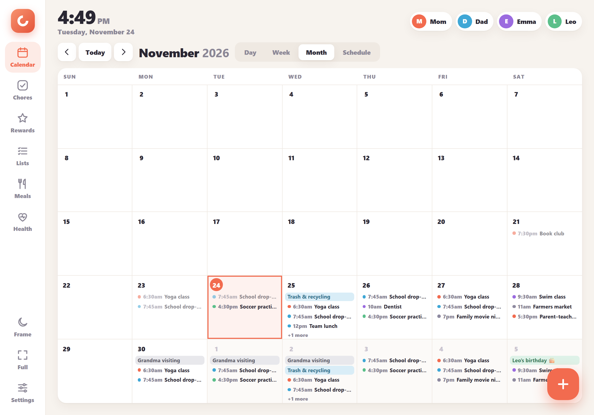

# Calendora

[](https://github.com/gh1d0ra/calendora/actions/workflows/ci.yml)


A touch-friendly family wall calendar that runs in any web browser. Put it full-screen on a tablet, a spare monitor or a TV and it becomes the family's shared hub.

**Live site:** https://gh1d0ra.github.io/calendora/

| Week (wall tablet) | Chores |
|---|---|
|  |  |
| **Month** | **Meal plan** |
|  |  |

<sub>Screenshots use the app's built-in demo family. Phone layout: [one day per screen](docs/screenshots/phone-week.png).</sub>

## How it's built

- **One Cloudflare Worker** serves the app and a JSON API on **D1** (SQLite), with a cron trigger (AnyList sync) and **Workers AI** (recipe photos, sorting lists).
- **Google sign-in, verified on the server:** RS256 ID tokens are checked against Google's keys. Families have owner, admin and member roles and invite links; wall tablets use a PBKDF2-hashed passcode with rate limiting.
- **Stateless HMAC-signed sessions**, with a per-family epoch for "sign out all devices".
- **Offline-first sync:** each device keeps a full copy. Saves are conditional on the board version, and conflicts are resolved with a section-by-section three-way merge.
- **Repeating events, time zones and iCalendar** are handled in `lib/core.js` (RRULE, EXDATE, moved and cancelled instances, daylight-saving changes) with no libraries.
- **Tested at three levels:** Vitest unit tests, API tests inside the real Workers runtime (workerd) with a local D1, and Playwright end-to-end tests on tablet and phone sizes, all run in GitHub Actions.

More: [architecture](docs/architecture.md) (diagrams, sync and sign-in flows) and [design decisions](docs/decisions/).

## Features

- **Calendar** with Day, Week, Month and Schedule views
  - Every family member gets a color. Tap their avatars in the header to show or hide their events.
  - Day view puts each person in their own column, with a "now" line.
  - Repeating events: daily, weekdays, weekly on chosen days, every 2 weeks, monthly and yearly, plus an optional end date. You can delete one occurrence, this and all following, or the whole series.
  - All-day and multi-day events, locations and notes.
  - Swipe left or right, or use the arrow keys, to move through dates.
- **Chores** in a column per person, grouped by morning, afternoon, evening and anytime. Each column has a progress ring, and finishing everything sets off confetti.
- **Rewards**: chores earn stars, and stars are redeemed for rewards the family sets up.
- **Lists** for groceries, to-dos, packing and so on. Add several items at once by separating them with commas.
- **Meal plan**: a week grid for breakfast, lunch, dinner and snacks. Dinner also shows on the week view. You can copy last week's meals, and a meal's ingredients can be sent to the grocery list.
- **Recipes**: attach a recipe to any meal by pasting a link (ingredients and steps are pulled from the page, and the original link is kept), taking or uploading a photo (keep the photo, or have Cloudflare Workers AI transcribe it), or typing it in. The 📖 button opens a cooking view that keeps the screen awake and stays open on that device until someone closes it, with ingredients you can tick off, the current step highlighted, and a button to add the ingredients to Groceries.
- **Photo frame**: when the calendar sits idle, it plays a slideshow of your photos with the time, the weather and today's events.
- **Google Calendar two-way sync**: show your Google calendars, give each one to a family member, and save new events straight to Google.
- **Apple (iCloud) calendars, read-only**: paste a calendar's Public Calendar link and choose whose it is. The Worker fetches the feed and the app expands repeating events, time zones, skipped dates and moved instances. It refreshes about every 15 minutes.
- **AnyList shopping-list sync (unofficial)**: keeps one Calendora list and one AnyList list matched in both directions, covering adding, renaming, checking off and deleting items. It runs every minute and right after the list is edited in Calendora. To set it up, add `ANYLIST_EMAIL` and `ANYLIST_PASSWORD` as Worker secrets, then switch it on in Settings.
- **Weather**: free forecast from Open-Meteo, shown in the header and on each day in the week view.
- Full-screen mode, a 12- or 24-hour clock, a choice of first day of the week, and backup export and import.

## Where data lives

Calendora is a Cloudflare Worker (`src/worker.js`). It serves the app files and a small JSON API backed by a Cloudflare D1 database.

- **Family board (shared):** members, events, chores and stars, rewards, lists, meals and settings are stored in D1 as one JSON document. Every signed-in device stays in sync: changes are saved within about half a second, and devices check for updates every 15 seconds.
- **Sign-in:** a single family passcode. D1 stores only a salted PBKDF2 hash of it. Each device stays signed in for a year through an HttpOnly cookie, and Settings can sign out every other device.
- **Kept on each device:** Google Calendar sign-in, photos (IndexedDB), and which members are shown or hidden.
- **Offline:** the app keeps working from its local copy and syncs when it's back online.

Opened anywhere else (a local file, or GitHub Pages), the app runs in local-only mode in the browser.

## Running it

It's plain HTML, CSS and JavaScript with no build step.

- Open `index.html` in a browser, or
- serve the folder with any static server, for example `python3 -m http.server`, or
- deploy to Cloudflare: Workers Builds redeploys on every push to `main`. The settings are in `wrangler.toml`, and the D1 tables are created automatically on first use.

Keyboard shortcuts: `←` and `→` move through dates, `t` jumps to today, `d`, `w`, `m` and `s` switch calendar views, and `n` adds a new item.

## Development and tests

```bash
npm install                                   # dev tools only (Vitest, Playwright, wrangler)
npm test                                      # unit tests (lib/core.js) + Worker API tests in workerd with a local D1
npx playwright install chromium               # once
npm run test:e2e                              # browser tests against wrangler dev on a fresh, seeded database
```

To try the app locally with a server:
```bash
node scripts/e2e-seed.mjs .wrangler/dev       # a test family: code E2ETEST, tablet passcode e2e-pass
npx wrangler dev --local --persist-to .wrangler/dev
```
Then open http://127.0.0.1:8787 and choose "Wall tablet? Sign in with a family code". `--local` keeps remote bindings such as Workers AI switched off.

| Suite | What it covers |
| --- | --- |
| `test/unit/core.test.js` | Every repeat option; month-end and leap-day rules; daylight-saving changes; a check that Calendora's repeat logic and the RRULE it sends to Google give the same days; iCalendar parsing and expansion (zones, overrides, cancellations, COUNT/UNTIL/BYDAY/BYMONTHDAY) |
| `test/worker/auth.test.js` | Google ID token checks (signature, audience, issuer, expiry, verified email), tablet passcodes and rate limiting, tampered cookies, sign out everywhere |
| `test/worker/family.test.js` | Creating and joining families, invites, roles, removing and leaving, handing over ownership, the new-family limit, board versions and conflicts, isolation between families |
| `test/worker/outside.test.js` | iCal proxy with its saved-copy fallback, feeds limited to the family's own, recipe import from schema.org data |
| `e2e/calendar.spec.mjs` | A tablet signs in, adds events (including a weekly one), the event is saved, and a second device sees it, at tablet and phone sizes |


## Files

| File | What it does |
| --- | --- |
| `index.html` | App shell |
| `styles.css` | All styling, including the tablet and phone layouts |
| `app.js` | State, rendering, modals, the photo frame, weather, Google sync and family sync |
| `lib/core.js` | Repeat rules and the iCalendar engine (no DOM; unit-tested) |
| `src/worker.js` | Cloudflare Worker: static files plus `/api` (passcode, sessions, shared board in D1) |
| `wrangler.toml` | Worker settings and the D1 binding |
| `test/`, `e2e/` | Vitest (unit + Worker) and Playwright tests |
| `docs/` | Architecture, decision records, screenshots |
| `.assetsignore` | Files the Worker must never serve (tests, docs, tooling) |

## Credits

AnyList has no public API. Calendora's AnyList sync talks to the same private protocol AnyList's own apps use. The protocol details (endpoints and message formats) come from the MIT-licensed [`anylist`](https://github.com/codetheweb/anylist) library by codetheweb. Calendora is not affiliated with or endorsed by AnyList, and the sync may stop working if AnyList changes its service.
