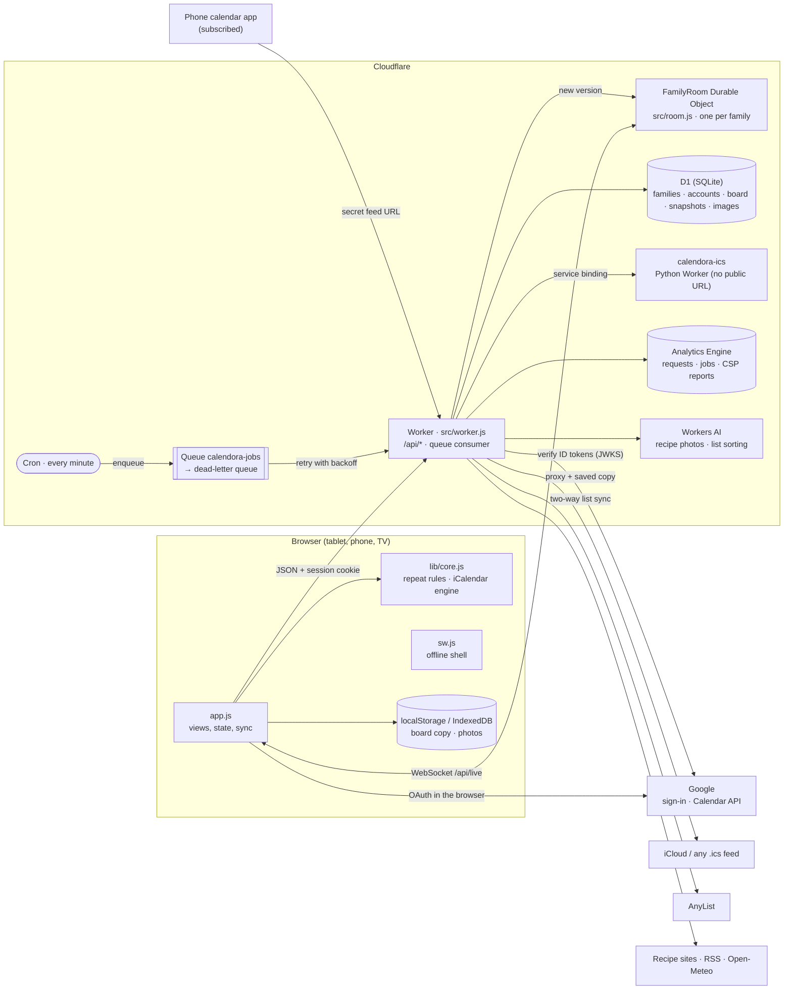
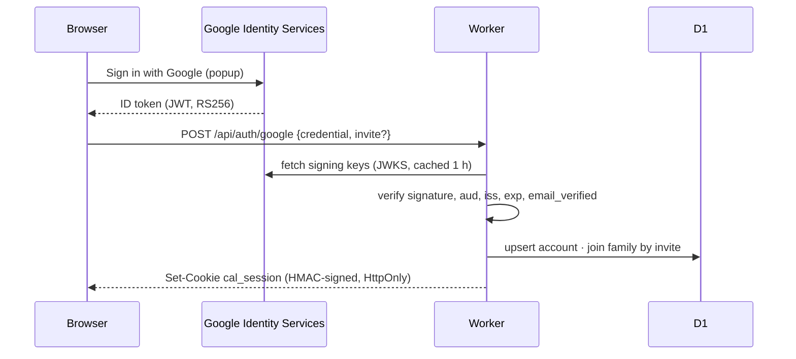
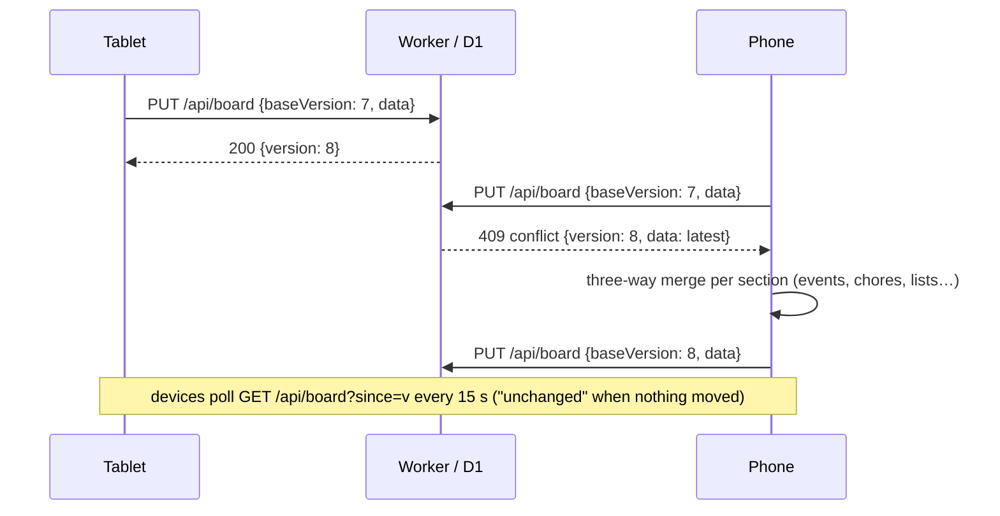

# Calendora architecture

Calendora is a family wall calendar: a vanilla-JavaScript single-page app plus one Cloudflare Worker. It runs
full-screen on a tablet or TV, and on phones. It's built to keep working when the network or an outside calendar
service doesn't.

## System overview



- **One Worker** serves the static files and `/api/*`. There's no build step: the files in the repo are the files that run.
  `.assetsignore` keeps tests, docs and tooling from being served.
- **The family board** (members, events, chores, lists, meals, settings) is a single JSON document per family in D1,
  versioned for optimistic concurrency (see below). Photos are stored separately, as D1 blobs.
- **Each device keeps a full copy** in `localStorage`, so the app starts instantly and keeps working offline.
  The service worker caches the app shell.

## Sign-in and families



- **People** sign in with Google; the Worker verifies the ID token itself (RS256 against Google's JWKS).
- **Wall tablets** sign in with the family's code and a passcode, so the kitchen screen needs no Google account.
  Passcodes are stored as PBKDF2-SHA256 (100k iterations). Failed attempts are limited per IP: 10 per 15 minutes.
- **Sessions** are stateless, HMAC-signed cookies: `2|familyId|googleSub|epoch|expires`. "Sign out all devices"
  increments the family's `epoch`, which invalidates every outstanding cookie at once.
- **Roles:** owner, admin and member. Invites are 10-character codes, valid for 14 days and up to 20 uses. When the owner leaves,
  ownership passes to an admin first, otherwise to the earliest member.

## Syncing the board between devices



The update is a single conditional write, `UPDATE board … WHERE id = ? AND version = ?`. Two devices can never
silently overwrite each other. On a conflict, the losing device merges section by section, comparing its last synced copy, its own copy and the server's:
it keeps its change where the other device left that section alone, takes the other device's version otherwise, and saves again.
Saves are debounced (600 ms).

### Live updates

```mermaid
sequenceDiagram
  participant P as Phone
  participant W as Worker
  participant D as D1
  participant R as FamilyRoom (Durable Object)
  participant T as Kitchen tablet
  T->>W: GET /api/live (Upgrade: websocket, session cookie)
  W->>R: forward to idFromName(familyId)
  R-->>T: 101 · {presence: 2 screens}
  Note over R: hibernates; sockets stay open, pings answered by the runtime
  P->>W: PUT /api/board {baseVersion: 8}
  W->>D: UPDATE … WHERE version = 8
  W-->>P: 200 {version: 9}
  W->>R: notify {board, version: 9}
  R-->>T: {type: board, version: 9}
  T->>W: GET /api/board?since=8
```

The room carries version numbers, never family data ([decision 0006](decisions/0006-live-sync-durable-objects.md)).
"Sign out all devices" closes every socket. Polling continues as a safety net: every minute while live, and every 15 s
without a live connection.

## Background jobs

AnyList sync and re-fetching calendars whose source is down run from the `calendora-jobs` queue. They retry with exponential
backoff (30 s up to 1 h) and go to `calendora-jobs-dlq` after the last try. The every-minute cron only enqueues.
When a calendar comes back, the job saves a fresh copy and tells the family's room, and open screens reload it.
See [decision 0007](decisions/0007-background-jobs-on-queues.md).

## Subscribe feeds (Python)

A manager creates a secret link (only its SHA-256 is stored). Calendar apps fetch `/api/feed/<token>.ics?member=…`. The
main Worker checks the token, loads the board and calls the `calendora-ics` **Python Worker** through a service binding.
The Python Worker turns the events into iCalendar: escaping, line folding, floating times, and RRULE/EXDATE that match
`toRRule`. The output is checked from both languages ([decision 0008](decisions/0008-python-worker-for-feeds.md)).

## Outside calendars

| Source | Where it runs | How |
|---|---|---|
| **Google Calendar** | Browser | OAuth per Google account; events are mapped to members by calendar. New events can be written back, and Calendora's repeat options become `RRULE`s via `toRRule`. The Worker keeps a last-good snapshot per calendar. |
| **Apple / iCloud (any .ics)** | Worker fetches, browser expands | The Worker fetches only feeds stored in the family's own board (no open proxy) and saves each good copy. If the source fails, it serves that copy with `X-Snapshot-At` and `X-Snapshot-Reason`. `lib/core.js` parses the feed and expands `RRULE` (DAILY, WEEKLY, MONTHLY and YEARLY, with BYDAY/BYMONTHDAY/BYMONTH, COUNT, UNTIL and INTERVAL), `EXDATE`, moved and cancelled `RECURRENCE-ID` instances, and `TZID` time zones through `Intl` (so daylight-saving changes are handled). |

## Testing

| Layer | Tool | What it covers |
|---|---|---|
| Pure logic | Vitest (Node, fixed `TZ`) | `lib/core.js`: every repeat option, daylight-saving and month-end edge cases; a **cross-check that Calendora's own repeat logic and the `RRULE` it sends to Google produce the same days**; the iCalendar engine (zones, overrides, cancellations, folding, escapes, windowing) |
| Worker API | Vitest + `@cloudflare/vitest-plugin` | The real `src/worker.js` inside **workerd with a local D1**. Google sign-in uses real RS256 tokens signed by a test key served as the JWKS. Covers families, roles, invites, sessions, rate limits, board conflicts, isolation between families, the iCal proxy with snapshot fallback, and recipe import |
| End-to-end | Playwright | `wrangler dev --local` on a fresh seeded database. A tablet signs in, adds events (including a weekly one), and a **second device sees them**. Runs at tablet and phone sizes, with internet access blocked |
| Live sync, queues, feeds | Vitest in workerd | WebSockets to the Durable Object (isolation, presence, sign-out closes sockets); the queue consumer's backoff and drops; subscribe links |
| Python | pytest (via uv) | The feed renderer; its output file is also read by the JS iCalendar engine (`test/unit/feed.test.js`) |
| Security | Playwright | Security headers, and no CSP reports during normal use |
| Load | k6 | 20 screens polling and saving at once: latency and conflict rate (`load/board.k6.js`, local only) |
| CI | GitHub Actions | Syntax check, all Vitest projects, Python tests, Terraform validation, a check that dev files are never served, and Playwright. Deploys stay with Cloudflare Workers Builds |

Operations: [observability](observability.md) (metrics, logs, targets) and [threat model](threat-model.md).

See [`docs/decisions/`](decisions/) for why it's built this way.
