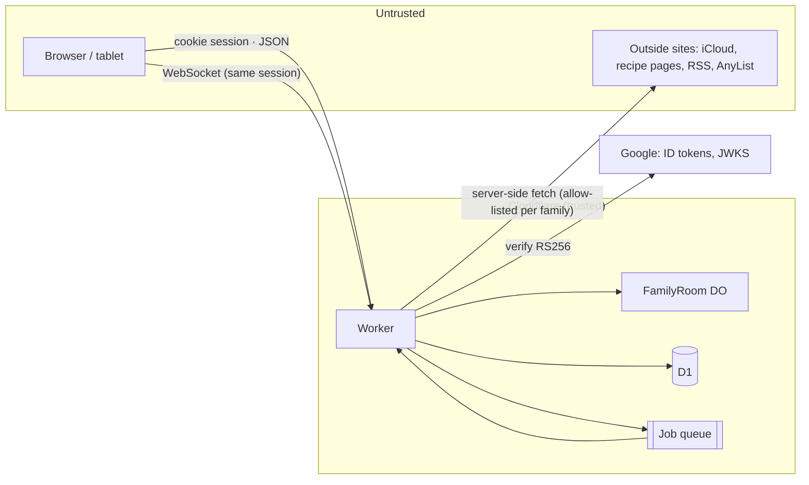

# Threat model

Calendora holds a family's schedule, children's names, chores, meal plans, recipe photos and links to their
calendars. That data is personal and sometimes reveals where people will be. It isn't financial data. The main risks are:
- another family (or a stranger) reading or changing a family's board;
- a lost or stolen wall tablet;
- the server being used to reach places it shouldn't.

## Assets and trust boundaries

| Asset | Where it lives | Who may read or write it |
|---|---|---|
| Family board (events, chores, lists, meals, settings) | D1 `board`, one JSON document per family | Signed-in members and that family's tablets |
| Accounts, roles, invites | D1 | The person themselves; owner and admins for roles and invites |
| Session signing key, tablet passcode hashes | D1 `config`, `families` | Only the Worker |
| AnyList credentials | Worker secrets (family #1), or sealed with a key the Worker holds | Only the Worker |
| Saved copies of calendars | D1 `snapshots` | That family's members |

## Threats and controls (STRIDE)

| # | Threat | Control | Tested in |
|---|---|---|---|
| S1 | Signing in as someone else with a forged Google token | ID token verified in the Worker against Google's JWKS: RS256 signature, `aud`, `iss`, `exp`, `email_verified` | `test/worker/auth.test.js` (wrong audience, expired, forged signature) |
| S2 | Guessing a tablet passcode | PBKDF2-SHA256 with 100k iterations; 10 failures per 15 minutes per IP | `auth.test.js` (lockout) |
| S3 | Forged or edited session cookie | HMAC-signed `2\|family\|sub\|epoch\|exp`; HttpOnly, Secure, SameSite=Lax | `auth.test.js` (tampered cookie) |
| S4 | Lost or stolen tablet | "Sign out all devices" increments the family's epoch, which invalidates every cookie *and* closes every live connection (code 4001) | `auth.test.js`, `live.test.js` |
| T1 | Two devices silently overwrite each other | Conditional `UPDATE … WHERE version = ?`, 409 with the server's copy, then a three-way merge per section | `family.test.js`, `load/board.k6.js` |
| T2 | Changing another family's board | Every query is scoped to the session's family id. No request parameter selects a family. | `family.test.js` (isolation) |
| R1 | "Who removed me?" | Roles are explicit (owner, admin, member). Removing someone or handing over ownership is limited to managers. | `family.test.js` |
| I1 | Reading another family's board, or its live updates | Board and `/api/live` both require the family's session. The room is chosen by the session's family id. Live messages carry only version numbers, never data. | `live.test.js` (families don't hear each other; no data on the socket) |
| I2 | Using the Worker as an open proxy (SSRF) to reach arbitrary URLs | `/api/ical` fetches only feeds stored in the caller's own board, by id. Recipe import and news require a session. Only http(s) is allowed. | `outside.test.js` |
| I3 | Script injection through event titles, feed text or recipe pages | Text is escaped before it goes into HTML (`esc`). Recipe and feed HTML is stripped server-side. CSP (report-only for now, see below). | `e2e/security.spec.mjs` |
| I4 | Personal addresses in the public repo | Owner emails are a Cloudflare variable, not in `wrangler.toml`. Git history was rewritten to remove them. | — |
| D1 | Flooding sign-in or family creation | Per-IP limits: 10 failed passcodes per 15 minutes, 3 new families per day. At most 50 live connections per family. | `auth.test.js`, `family.test.js` |
| D2 | One family's broken calendar or AnyList account slows everyone | That work runs on the job queue, with per-message retries and backoff and a dead-letter queue. Saved copies are served while a source is down. | `jobs.test.js`, `outside.test.js` |
| E1 | A member acting as owner or admin | Role checks on every family-management route. Tablets aren't people and can't manage the family. | `family.test.js` |

## Browser hardening

The `_headers` file adds `X-Content-Type-Options`, `X-Frame-Options: DENY`, a strict `Permissions-Policy`, HSTS,
and a **Content-Security-Policy in report-only mode**. Under the policy:
- scripts come only from the app itself and Google's sign-in script;
- the page can't be framed;
- plugins, `<base>` changes and outside form posts are blocked.

Reports go to `/api/csp-report` and are logged and counted. The browser tests check that the app's normal flows trigger
no reports. Once a week of real use passes with none, the header will switch to enforcing. Report-only first, because
a wrong policy on a wall tablet would break the family's calendar with nobody at a keyboard to notice.

## Known gaps

- **Removed members' open live connections.** When someone is removed from a family, their open live connection
  isn't closed. It still receives version numbers, but no data, until it reconnects. Their next board request
  is refused.
- **Recipe photos.** Uploads are checked for size, count and declared type (JPEG, PNG or WebP), but the bytes are not sniffed or re-encoded.
- **Inline styles.** The CSP still allows `'unsafe-inline'` for styles, because the app sets colors with inline styles.
